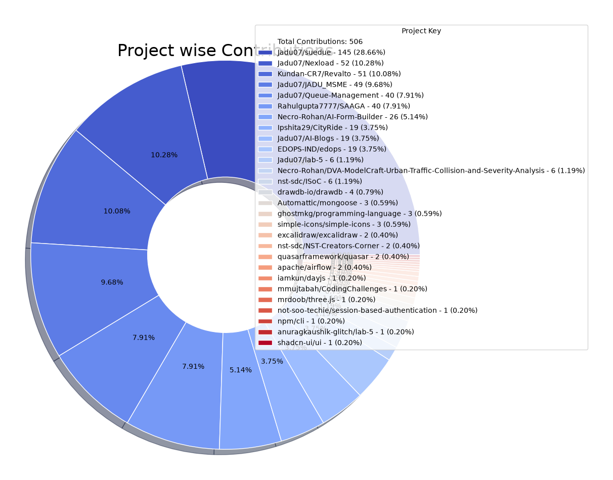
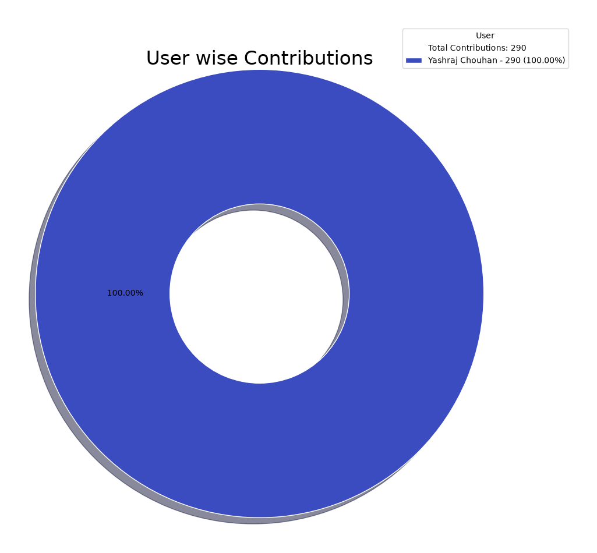

# OpenSource Contributions Report

*Report auto-generated on: 2026-10-30 04:09:05 for period 2023-01-01 to 2026-10-31*

## Overall Summary

| Metric | Value |
|--------|-------|
| Total number of projects | 25 |
| Total number of repositories | 28 |
| Total number of contributions | 291 |
| Number of commits to master* | 276 |
| Number of pull requests (Open)* | 10 |
| Number of pull requests (Closed) | 117 |
| Number of issues (Open)* | 1 |
| Number of issues (Closed)* | 2 |
| Total unique PRs reviewed* | 2 |

**Note:** Fields marked with * contribute to the total contribution count.

  
  

## Summary of Contributions by each project

| Project Key | Repositories | Users | Commits | Pull Requests (Open) | Pull Requests (Closed) | Issues (Open) | Issues (Closed) | Code Reviews | Overall Contribution |
|--------------|--------------|-------|---------|----------------------|----------------------|----------------|----------------|--------------|----------------------|
| Kundan-CR7/Revalto |  [Kundan-CR7/Revalto](https://github.com/Kundan-CR7/Revalto) |  [Yashraj Chouhan](https://github.com/Jadu07) | 51 | 0 | 25 | 0 | 0 | 0 | 51 |
| Jadu07/JADU_MSME |  [Jadu07/JADU_MSME](https://github.com/Jadu07/JADU_MSME) |  [Yashraj Chouhan](https://github.com/Jadu07) | 49 | 0 | 14 | 0 | 0 | 0 | 49 |
| Jadu07/Queue-Management |  [Jadu07/Queue-Management](https://github.com/Jadu07/Queue-Management) |  [Yashraj Chouhan](https://github.com/Jadu07) | 40 | 0 | 1 | 0 | 0 | 0 | 40 |
| Rahulgupta7777/SAAGA |  [Rahulgupta7777/SAAGA](https://github.com/Rahulgupta7777/SAAGA) |  [Yashraj Chouhan](https://github.com/Jadu07) | 40 | 0 | 22 | 0 | 0 | 0 | 40 |
| Necro-Rohan/AI-Form-Builder |  [Necro-Rohan/AI-Form-Builder](https://github.com/Necro-Rohan/AI-Form-Builder) |  [Yashraj Chouhan](https://github.com/Jadu07) | 26 | 0 | 3 | 0 | 0 | 0 | 26 |
| EDOPS-IND/edops |  [EDOPS-IND/edops](https://github.com/EDOPS-IND/edops) |  [Yashraj Chouhan](https://github.com/Jadu07) | 19 | 1 | 13 | 0 | 0 | 0 | 20 |
| Ipshita29/CityRide |  [Ipshita29/CityRide](https://github.com/Ipshita29/CityRide) |  [Yashraj Chouhan](https://github.com/Jadu07) | 19 | 0 | 9 | 0 | 0 | 0 | 19 |
| Necro-Rohan/DVA-ModelCraft-Urban-Traffic-Collision-and-Severity-Analysis |  [Necro-Rohan/DVA-ModelCraft-Urban-Traffic-Collision-and-Severity-Analysis](https://github.com/Necro-Rohan/DVA-ModelCraft-Urban-Traffic-Collision-and-Severity-Analysis) |  [Yashraj Chouhan](https://github.com/Jadu07) | 6 | 0 | 3 | 0 | 0 | 0 | 6 |
| Jadu07/lab-5 |  [Jadu07/lab-5](https://github.com/Jadu07/lab-5) |  [Yashraj Chouhan](https://github.com/Jadu07) | 6 | 0 | 1 | 0 | 0 | 0 | 6 |
| nst-sdc/ISoC |  [nst-sdc/ISoC](https://github.com/nst-sdc/ISoC) |  [Yashraj Chouhan](https://github.com/Jadu07) | 6 | 0 | 5 | 0 | 0 | 0 | 6 |
| drawdb-io/drawdb |  [drawdb-io/drawdb](https://github.com/drawdb-io/drawdb) |  [Yashraj Chouhan](https://github.com/Jadu07) | 1 | 2 | 1 | 0 | 1 | 0 | 4 |
| Automattic/mongoose |  [Automattic/mongoose](https://github.com/Automattic/mongoose) |  [Yashraj Chouhan](https://github.com/Jadu07) | 2 | 0 | 1 | 0 | 0 | 1 | 3 |
| ghostmkg/programming-language |  [ghostmkg/programming-language](https://github.com/ghostmkg/programming-language) |  [Yashraj Chouhan](https://github.com/Jadu07) | 3 | 0 | 4 | 0 | 0 | 0 | 3 |
| simple-icons/simple-icons |  [simple-icons/simple-icons](https://github.com/simple-icons/simple-icons) |  [Yashraj Chouhan](https://github.com/Jadu07) | 0 | 2 | 0 | 0 | 0 | 1 | 3 |
| nst-sdc/NST-Creators-Corner |  [nst-sdc/NST-Creators-Corner](https://github.com/nst-sdc/NST-Creators-Corner) |  [Yashraj Chouhan](https://github.com/Jadu07) | 1 | 0 | 1 | 0 | 1 | 0 | 2 |
| excalidraw/excalidraw |  [excalidraw/excalidraw](https://github.com/excalidraw/excalidraw) |  [Yashraj Chouhan](https://github.com/Jadu07) | 0 | 1 | 0 | 1 | 0 | 0 | 2 |
| apache/airflow |  [apache/airflow](https://github.com/apache/airflow) |  [Yashraj Chouhan](https://github.com/Jadu07) | 2 | 0 | 2 | 0 | 0 | 0 | 2 |
| quasarframework/quasar |  [quasarframework/quasar](https://github.com/quasarframework/quasar) |  [Yashraj Chouhan](https://github.com/Jadu07) | 2 | 0 | 4 | 0 | 0 | 0 | 2 |
| mmujtabah/CodingChallenges |  [mmujtabah/CodingChallenges](https://github.com/mmujtabah/CodingChallenges) |  [Yashraj Chouhan](https://github.com/Jadu07) | 1 | 0 | 1 | 0 | 0 | 0 | 1 |
| anuragkaushik-glitch/lab-5 |  [anuragkaushik-glitch/lab-5](https://github.com/anuragkaushik-glitch/lab-5) |  [Yashraj Chouhan](https://github.com/Jadu07) | 0 | 1 | 0 | 0 | 0 | 0 | 1 |
| iamkun/dayjs |  [iamkun/dayjs](https://github.com/iamkun/dayjs) |  [Yashraj Chouhan](https://github.com/Jadu07) | 0 | 1 | 0 | 0 | 0 | 0 | 1 |
| npm/cli |  [npm/cli](https://github.com/npm/cli) |  [Yashraj Chouhan](https://github.com/Jadu07) | 1 | 0 | 1 | 0 | 0 | 0 | 1 |
| not-soo-techie/session-based-authentication |  [not-soo-techie/session-based-authentication](https://github.com/not-soo-techie/session-based-authentication) |  [Yashraj Chouhan](https://github.com/Jadu07) | 0 | 1 | 0 | 0 | 0 | 0 | 1 |
| mrdoob/three.js |  [mrdoob/three.js](https://github.com/mrdoob/three.js) |  [Yashraj Chouhan](https://github.com/Jadu07) | 1 | 0 | 3 | 0 | 0 | 0 | 1 |
| shadcn-ui/ui |  [shadcn-ui/ui](https://github.com/shadcn-ui/ui) |  [Yashraj Chouhan](https://github.com/Jadu07) | 0 | 1 | 0 | 0 | 0 | 0 | 1 |

## Summary of Contributions by each user

| User | Repositories | Commits | Pull Requests (Open) | Pull Requests (Closed) | Issues (Open) | Issues (Closed) | Code Reviews | Overall Contribution |
|------|--------------|---------|----------------------|----------------------|----------------|----------------|--------------|----------------------|
|  [Yashraj Chouhan](https://github.com/Jadu07) |  [Automattic/mongoose](https://github.com/Automattic/mongoose)  [EDOPS-IND/edops](https://github.com/EDOPS-IND/edops)  [Ipshita29/CityRide](https://github.com/Ipshita29/CityRide)  [Jadu07/JADU_MSME](https://github.com/Jadu07/JADU_MSME)  [Jadu07/Queue-Management](https://github.com/Jadu07/Queue-Management)  [Jadu07/lab-5](https://github.com/Jadu07/lab-5)  [Kundan-CR7/Revalto](https://github.com/Kundan-CR7/Revalto)  [Necro-Rohan/AI-Form-Builder](https://github.com/Necro-Rohan/AI-Form-Builder)  [Necro-Rohan/DVA-ModelCraft-Urban-Traffic-Collision-and-Severity-Analysis](https://github.com/Necro-Rohan/DVA-ModelCraft-Urban-Traffic-Collision-and-Severity-Analysis)  [Rahulgupta7777/SAAGA](https://github.com/Rahulgupta7777/SAAGA)  [anuragkaushik-glitch/lab-5](https://github.com/anuragkaushik-glitch/lab-5)  [apache/airflow](https://github.com/apache/airflow)  [drawdb-io/drawdb](https://github.com/drawdb-io/drawdb)  [excalidraw/excalidraw](https://github.com/excalidraw/excalidraw)  [ghostmkg/programming-language](https://github.com/ghostmkg/programming-language)  [ghostmkg/web-development](https://github.com/ghostmkg/web-development)  [hk2166/Scaler-Hacks](https://github.com/hk2166/Scaler-Hacks)  [iamkun/dayjs](https://github.com/iamkun/dayjs)  [mmujtabah/CodingChallenges](https://github.com/mmujtabah/CodingChallenges)  [mrdoob/three.js](https://github.com/mrdoob/three.js)  [not-soo-techie/session-based-authentication](https://github.com/not-soo-techie/session-based-authentication)  [npm/cli](https://github.com/npm/cli)  [nst-sdc/ISoC](https://github.com/nst-sdc/ISoC)  [nst-sdc/NST-Creators-Corner](https://github.com/nst-sdc/NST-Creators-Corner)  [quasarframework/quasar](https://github.com/quasarframework/quasar)  [shadcn-ui/ui](https://github.com/shadcn-ui/ui)  [simple-icons/simple-icons](https://github.com/simple-icons/simple-icons)  [sympy/sympy](https://github.com/sympy/sympy) | 276 | 10 | 117 | 1 | 2 | 2 | 291 |

## Detailed Contributions

| Project Key | Repository | User | Rank | Commits | Pull Requests (Open) | Pull Requests (Closed) | Issues (Open) | Issues (Closed) | Code Reviews | Overall Contribution |
|--------------|------------|------|------|---------|----------------------|----------------------|----------------|----------------|--------------|----------------------|
| anuragkaushik-glitch/lab-5 |  [anuragkaushik-glitch/lab-5](https://github.com/anuragkaushik-glitch/lab-5) |  [Yashraj Chouhan](https://github.com/Jadu07) | N/A | 0 | 1 | 0 | 0 | 0 | 0 | 1 |
| shadcn-ui/ui |  [shadcn-ui/ui](https://github.com/shadcn-ui/ui) |  [Yashraj Chouhan](https://github.com/Jadu07) | N/A | 0 | 1 | 0 | 0 | 0 | 0 | 1 |
| Rahulgupta7777/SAAGA |  [Rahulgupta7777/SAAGA](https://github.com/Rahulgupta7777/SAAGA) |  [Yashraj Chouhan](https://github.com/Jadu07) | 2 | 40 | 0 | 22 | 0 | 0 | 0 | 40 |
| quasarframework/quasar |  [quasarframework/quasar](https://github.com/quasarframework/quasar) |  [Yashraj Chouhan](https://github.com/Jadu07) | 132 | 2 | 0 | 4 | 0 | 0 | 0 | 2 |
| nst-sdc/NST-Creators-Corner |  [nst-sdc/NST-Creators-Corner](https://github.com/nst-sdc/NST-Creators-Corner) |  [Yashraj Chouhan](https://github.com/Jadu07) | 11 | 1 | 0 | 1 | 0 | 1 | 0 | 2 |
| nst-sdc/ISoC |  [nst-sdc/ISoC](https://github.com/nst-sdc/ISoC) |  [Yashraj Chouhan](https://github.com/Jadu07) | 3 | 6 | 0 | 5 | 0 | 0 | 0 | 6 |
| npm/cli |  [npm/cli](https://github.com/npm/cli) |  [Yashraj Chouhan](https://github.com/Jadu07) | N/A | 1 | 0 | 1 | 0 | 0 | 0 | 1 |
| not-soo-techie/session-based-authentication |  [not-soo-techie/session-based-authentication](https://github.com/not-soo-techie/session-based-authentication) |  [Yashraj Chouhan](https://github.com/Jadu07) | N/A | 0 | 1 | 0 | 0 | 0 | 0 | 1 |
| Necro-Rohan/DVA-ModelCraft-Urban-Traffic-Collision-and-Severity-Analysis |  [Necro-Rohan/DVA-ModelCraft-Urban-Traffic-Collision-and-Severity-Analysis](https://github.com/Necro-Rohan/DVA-ModelCraft-Urban-Traffic-Collision-and-Severity-Analysis) |  [Yashraj Chouhan](https://github.com/Jadu07) | 3 | 6 | 0 | 3 | 0 | 0 | 0 | 6 |
| Necro-Rohan/AI-Form-Builder |  [Necro-Rohan/AI-Form-Builder](https://github.com/Necro-Rohan/AI-Form-Builder) |  [Yashraj Chouhan](https://github.com/Jadu07) | 1 | 26 | 0 | 3 | 0 | 0 | 0 | 26 |
| mrdoob/three.js |  [mrdoob/three.js](https://github.com/mrdoob/three.js) |  [Yashraj Chouhan](https://github.com/Jadu07) | N/A | 1 | 0 | 3 | 0 | 0 | 0 | 1 |
| mmujtabah/CodingChallenges |  [mmujtabah/CodingChallenges](https://github.com/mmujtabah/CodingChallenges) |  [Yashraj Chouhan](https://github.com/Jadu07) | 11 | 1 | 0 | 1 | 0 | 0 | 0 | 1 |
| Kundan-CR7/Revalto |  [Kundan-CR7/Revalto](https://github.com/Kundan-CR7/Revalto) |  [Yashraj Chouhan](https://github.com/Jadu07) | 1 | 51 | 0 | 25 | 0 | 0 | 0 | 51 |
| Jadu07/Queue-Management |  [Jadu07/Queue-Management](https://github.com/Jadu07/Queue-Management) |  [Yashraj Chouhan](https://github.com/Jadu07) | 1 | 40 | 0 | 1 | 0 | 0 | 0 | 40 |
| Jadu07/lab-5 |  [Jadu07/lab-5](https://github.com/Jadu07/lab-5) |  [Yashraj Chouhan](https://github.com/Jadu07) | 1 | 6 | 0 | 1 | 0 | 0 | 0 | 6 |
| Jadu07/JADU_MSME |  [Jadu07/JADU_MSME](https://github.com/Jadu07/JADU_MSME) |  [Yashraj Chouhan](https://github.com/Jadu07) | 1 | 49 | 0 | 14 | 0 | 0 | 0 | 49 |
| Ipshita29/CityRide |  [Ipshita29/CityRide](https://github.com/Ipshita29/CityRide) |  [Yashraj Chouhan](https://github.com/Jadu07) | 3 | 19 | 0 | 9 | 0 | 0 | 0 | 19 |
| iamkun/dayjs |  [iamkun/dayjs](https://github.com/iamkun/dayjs) |  [Yashraj Chouhan](https://github.com/Jadu07) | N/A | 0 | 1 | 0 | 0 | 0 | 0 | 1 |
| hk2166/Scaler-Hacks |  [hk2166/Scaler-Hacks](https://github.com/hk2166/Scaler-Hacks) |  [Yashraj Chouhan](https://github.com/Jadu07) | N/A | 0 | 0 | 1 | 0 | 0 | 0 | 0 |
| ghostmkg/web-development |  [ghostmkg/web-development](https://github.com/ghostmkg/web-development) |  [Yashraj Chouhan](https://github.com/Jadu07) | N/A | 0 | 0 | 1 | 0 | 0 | 0 | 0 |
| ghostmkg/programming-language |  [ghostmkg/programming-language](https://github.com/ghostmkg/programming-language) |  [Yashraj Chouhan](https://github.com/Jadu07) | 64 | 3 | 0 | 4 | 0 | 0 | 0 | 3 |
| excalidraw/excalidraw |  [excalidraw/excalidraw](https://github.com/excalidraw/excalidraw) |  [Yashraj Chouhan](https://github.com/Jadu07) | N/A | 0 | 1 | 0 | 1 | 0 | 0 | 2 |
| EDOPS-IND/edops |  [EDOPS-IND/edops](https://github.com/EDOPS-IND/edops) |  [Yashraj Chouhan](https://github.com/Jadu07) | 2 | 19 | 1 | 13 | 0 | 0 | 0 | 20 |
| drawdb-io/drawdb |  [drawdb-io/drawdb](https://github.com/drawdb-io/drawdb) |  [Yashraj Chouhan](https://github.com/Jadu07) | 93 | 1 | 2 | 1 | 0 | 1 | 0 | 4 |
| Automattic/mongoose |  [Automattic/mongoose](https://github.com/Automattic/mongoose) |  [Yashraj Chouhan](https://github.com/Jadu07) | 278 | 2 | 0 | 1 | 0 | 0 | 1 | 3 |
| apache/airflow |  [apache/airflow](https://github.com/apache/airflow) |  [Yashraj Chouhan](https://github.com/Jadu07) | N/A | 2 | 0 | 2 | 0 | 0 | 0 | 2 |
| simple-icons/simple-icons |  [simple-icons/simple-icons](https://github.com/simple-icons/simple-icons) |  [Yashraj Chouhan](https://github.com/Jadu07) | N/A | 0 | 2 | 0 | 0 | 0 | 1 | 3 |
| sympy/sympy |  [sympy/sympy](https://github.com/sympy/sympy) |  [Yashraj Chouhan](https://github.com/Jadu07) | N/A | 0 | 0 | 1 | 0 | 0 | 0 | 0 |

## Activity Details

###  [Yashraj Chouhan](https://github.com/Jadu07)

#### Automattic/mongoose

##### [Automattic/mongoose](https://github.com/Automattic/mongoose)

**Pull Requests**

| # | Title | Status | Created | Updated | Labels |
|---|-------|--------|---------|---------|--------|
| [#15735](https://github.com/Automattic/mongoose/pull/15735) | feat: add index and doc to insertMany validation errors | ✅ Merged | 2025-11-10 | 2025-11-13 | enhancement, developer-experience |

#### EDOPS-IND/edops

##### [EDOPS-IND/edops](https://github.com/EDOPS-IND/edops)

**Pull Requests**

| # | Title | Status | Created | Updated | Labels |
|---|-------|--------|---------|---------|--------|
| [#1](https://github.com/EDOPS-IND/edops/pull/1) | feat: add EDOPS dashboard frontend | ✅ Merged | 2026-09-26 | 2026-09-26 |  |
| [#6](https://github.com/EDOPS-IND/edops/pull/6) | fix: login and accept invitation UI alignment and API fixes | ✅ Merged | 2026-10-08 | 2026-10-08 |  |
| [#7](https://github.com/EDOPS-IND/edops/pull/7) | feat: complete redesign of school admin dashboard and workspace UI | ✅ Merged | 2026-10-09 | 2026-10-09 |  |
| [#16](https://github.com/EDOPS-IND/edops/pull/16) | feat: redesign student, teacher, principal, and parent dashboards to … | ✅ Merged | 2026-10-16 | 2026-10-16 |  |
| [#17](https://github.com/EDOPS-IND/edops/pull/17) | feat(student): update student dashboard illustration and workspace panes | ✅ Merged | 2026-10-18 | 2026-10-18 |  |
| [#18](https://github.com/EDOPS-IND/edops/pull/18) | feat(teacher): Teacher Workspace UI Overhaul & Student 360 Parity | ✅ Merged | 2026-10-18 | 2026-10-18 |  |
| [#19](https://github.com/EDOPS-IND/edops/pull/19) | Feat/school admin dashboard redesign | ✅ Merged | 2026-10-18 | 2026-10-18 |  |
| [#20](https://github.com/EDOPS-IND/edops/pull/20) | Feat/principal parent dashboard redesign | ✅ Merged | 2026-10-18 | 2026-10-18 |  |
| [#22](https://github.com/EDOPS-IND/edops/pull/22) | feat(brand): integrate official EDOPSLogo.png across all workspaces, auth screens, and dashboards | ✅ Merged | 2026-10-19 | 2026-10-19 |  |
| [#23](https://github.com/EDOPS-IND/edops/pull/23) | feat: deep-link routing and bidirectional subtabs architecture across all dashboards | ✅ Merged | 2026-10-19 | 2026-10-19 |  |
| [#29](https://github.com/EDOPS-IND/edops/pull/29) | feat: add student activity audit log and pending invite support to sc… | ✅ Merged | 2026-10-22 | 2026-10-22 |  |
| [#30](https://github.com/EDOPS-IND/edops/pull/30) | feat(school-admin): make dashboard full-width, format null/0 metrics … | ✅ Merged | 2026-10-22 | 2026-10-22 |  |
| [#31](https://github.com/EDOPS-IND/edops/pull/31) | feat(school-admin): polish academics dossiers, sticky bottom edit actions, and stacked drawers | ✅ Merged | 2026-10-22 | 2026-10-22 |  |
| [#50](https://github.com/EDOPS-IND/edops/pull/50) | fix principal dashboard | 🔄 Open | 2026-10-27 | 2026-10-27 |  |

#### Ipshita29/CityRide

##### [Ipshita29/CityRide](https://github.com/Ipshita29/CityRide)

**Pull Requests**

| # | Title | Status | Created | Updated | Labels |
|---|-------|--------|---------|---------|--------|
| [#6](https://github.com/Ipshita29/CityRide/pull/6) | Implemented Backend + change sin folder structure | ✅ Merged | 2025-11-28 | 2025-11-28 |  |
| [#7](https://github.com/Ipshita29/CityRide/pull/7) | fix backend deployment | ✅ Merged | 2025-11-28 | 2025-11-28 |  |
| [#8](https://github.com/Ipshita29/CityRide/pull/8) | Deployment | ✅ Merged | 2025-11-28 | 2025-11-28 |  |
| [#10](https://github.com/Ipshita29/CityRide/pull/10) | Add build script | ✅ Merged | 2025-11-28 | 2025-11-28 |  |
| [#11](https://github.com/Ipshita29/CityRide/pull/11) | added postinstall | ✅ Merged | 2025-11-28 | 2025-11-28 |  |
| [#13](https://github.com/Ipshita29/CityRide/pull/13) | implemented home page | ✅ Merged | 2025-11-28 | 2025-11-28 |  |
| [#14](https://github.com/Ipshita29/CityRide/pull/14) | fix homepage | ✅ Merged | 2025-11-28 | 2025-11-28 |  |
| [#25](https://github.com/Ipshita29/CityRide/pull/25) | fixed safe area view error | ✅ Merged | 2025-11-29 | 2025-11-29 |  |
| [#31](https://github.com/Ipshita29/CityRide/pull/31) | fixed routedetails | ✅ Merged | 2025-11-29 | 2025-11-29 |  |

#### Jadu07/JADU_MSME

##### [Jadu07/JADU_MSME](https://github.com/Jadu07/JADU_MSME)

**Pull Requests**

| # | Title | Status | Created | Updated | Labels |
|---|-------|--------|---------|---------|--------|
| [#2](https://github.com/Jadu07/JADU_MSME/pull/2) | login and signup implementation | ✅ Merged | 2026-01-31 | 2026-01-31 |  |
| [#3](https://github.com/Jadu07/JADU_MSME/pull/3) | improved dashboard ui | ✅ Merged | 2026-01-31 | 2026-01-31 |  |
| [#5](https://github.com/Jadu07/JADU_MSME/pull/5) | added agentic ai sidebar | ✅ Merged | 2026-01-31 | 2026-01-31 |  |
| [#14](https://github.com/Jadu07/JADU_MSME/pull/14) | implemented notification and sidebar ui  | ✅ Merged | 2026-01-31 | 2026-01-31 |  |
| [#16](https://github.com/Jadu07/JADU_MSME/pull/16) | added inventory ui | ✅ Merged | 2026-01-31 | 2026-01-31 |  |
| [#28](https://github.com/Jadu07/JADU_MSME/pull/28) | Authdb | ✅ Merged | 2026-01-31 | 2026-01-31 |  |
| [#29](https://github.com/Jadu07/JADU_MSME/pull/29) | fixed login | ✅ Merged | 2026-01-31 | 2026-01-31 |  |
| [#30](https://github.com/Jadu07/JADU_MSME/pull/30) | added o auth | ✅ Merged | 2026-01-31 | 2026-01-31 |  |
| [#31](https://github.com/Jadu07/JADU_MSME/pull/31) | full_supp_inv | ✅ Merged | 2026-01-31 | 2026-02-01 |  |
| [#33](https://github.com/Jadu07/JADU_MSME/pull/33) | fix_err | ✅ Merged | 2026-02-01 | 2026-02-01 |  |
| [#34](https://github.com/Jadu07/JADU_MSME/pull/34) | staff | ✅ Merged | 2026-02-01 | 2026-02-01 |  |
| [#36](https://github.com/Jadu07/JADU_MSME/pull/36) | dashboard | ✅ Merged | 2026-02-01 | 2026-02-01 |  |
| [#37](https://github.com/Jadu07/JADU_MSME/pull/37) | salesnorders | ✅ Merged | 2026-02-01 | 2026-02-01 |  |
| [#41](https://github.com/Jadu07/JADU_MSME/pull/41) | ai | ✅ Merged | 2026-02-01 | 2026-02-01 |  |

#### Jadu07/Queue-Management

##### [Jadu07/Queue-Management](https://github.com/Jadu07/Queue-Management)

**Pull Requests**

| # | Title | Status | Created | Updated | Labels |
|---|-------|--------|---------|---------|--------|
| [#1](https://github.com/Jadu07/Queue-Management/pull/1) | Update backend API URL to Vercel deployment | ✅ Merged | 2026-01-27 | 2026-01-27 |  |

#### Jadu07/lab-5

##### [Jadu07/lab-5](https://github.com/Jadu07/lab-5)

**Pull Requests**

| # | Title | Status | Created | Updated | Labels |
|---|-------|--------|---------|---------|--------|
| [#1](https://github.com/Jadu07/lab-5/pull/1) | on pull workflow | ✅ Merged | 2026-02-23 | 2026-02-23 |  |

#### Kundan-CR7/Revalto

##### [Kundan-CR7/Revalto](https://github.com/Kundan-CR7/Revalto)

**Pull Requests**

| # | Title | Status | Created | Updated | Labels |
|---|-------|--------|---------|---------|--------|
| [#1](https://github.com/Kundan-CR7/Revalto/pull/1) | first user schema | ✅ Merged | 2025-09-21 | 2025-09-21 |  |
| [#2](https://github.com/Kundan-CR7/Revalto/pull/2) | Added a get request with route "/" | ✅ Merged | 2025-09-21 | 2025-09-21 |  |
| [#11](https://github.com/Kundan-CR7/Revalto/pull/11) | added login page | ✅ Merged | 2025-10-29 | 2025-10-29 |  |
| [#17](https://github.com/Kundan-CR7/Revalto/pull/17) | improved homepage | ✅ Merged | 2025-11-01 | 2025-11-01 |  |
| [#18](https://github.com/Kundan-CR7/Revalto/pull/18) | implemeted ui friendly login page and register page | ✅ Merged | 2025-11-01 | 2025-11-01 |  |
| [#19](https://github.com/Kundan-CR7/Revalto/pull/19) | Edit Profile Page | ✅ Merged | 2025-11-01 | 2025-11-01 |  |
| [#22](https://github.com/Kundan-CR7/Revalto/pull/22) | updated to reusable components | ✅ Merged | 2025-11-02 | 2025-11-02 |  |
| [#23](https://github.com/Kundan-CR7/Revalto/pull/23) | improved folder structure | ✅ Merged | 2025-11-04 | 2025-11-04 |  |
| [#32](https://github.com/Kundan-CR7/Revalto/pull/32) | Implemented get Route | ✅ Merged | 2025-11-09 | 2025-11-09 |  |
| [#33](https://github.com/Kundan-CR7/Revalto/pull/33) | Implemented profile page | ✅ Merged | 2025-11-09 | 2025-11-09 |  |
| [#41](https://github.com/Kundan-CR7/Revalto/pull/41) | Moved Icons To Public Folder | ✅ Merged | 2025-11-22 | 2025-11-22 |  |
| [#42](https://github.com/Kundan-CR7/Revalto/pull/42) | added product page with get request | ✅ Merged | 2025-11-22 | 2025-11-22 |  |
| [#43](https://github.com/Kundan-CR7/Revalto/pull/43) | pagination set to 20 | ✅ Merged | 2025-11-22 | 2025-11-22 |  |
| [#44](https://github.com/Kundan-CR7/Revalto/pull/44) | added add product page with cloudnary setup | ✅ Merged | 2025-11-22 | 2025-11-22 |  |
| [#46](https://github.com/Kundan-CR7/Revalto/pull/46) | Revert "refactor: removed jQuery carousel and added React-Swiper implementation for smooth, responsive slider." | ✅ Merged | 2025-11-22 | 2025-11-22 |  |
| [#48](https://github.com/Kundan-CR7/Revalto/pull/48) | added sell page with product posted by user | ✅ Merged | 2025-11-23 | 2025-11-23 |  |
| [#49](https://github.com/Kundan-CR7/Revalto/pull/49) | modified product card for homepage | ✅ Merged | 2025-11-23 | 2025-11-23 |  |
| [#50](https://github.com/Kundan-CR7/Revalto/pull/50) | if posted anom.. then display username as anonid | ✅ Merged | 2025-11-23 | 2025-11-23 |  |
| [#53](https://github.com/Kundan-CR7/Revalto/pull/53) | added Edit page for Products | ✅ Merged | 2025-11-23 | 2025-11-23 |  |
| [#54](https://github.com/Kundan-CR7/Revalto/pull/54) | ui changes of add product | ✅ Merged | 2025-11-23 | 2025-11-23 |  |
| [#56](https://github.com/Kundan-CR7/Revalto/pull/56) | Configure for Vercel deployment | ✅ Merged | 2025-11-30 | 2025-11-30 |  |
| [#57](https://github.com/Kundan-CR7/Revalto/pull/57) | Add postinstall script for Prisma | ✅ Merged | 2025-11-30 | 2025-11-30 |  |
| [#58](https://github.com/Kundan-CR7/Revalto/pull/58) | Allow production frontend in CORS | ✅ Merged | 2025-11-30 | 2025-11-30 |  |
| [#59](https://github.com/Kundan-CR7/Revalto/pull/59) | Force socket polling for Vercel | ✅ Merged | 2025-11-30 | 2025-11-30 |  |
| [#60](https://github.com/Kundan-CR7/Revalto/pull/60) | Route Vercel requests through HTTP server for Socket.IO | ✅ Merged | 2025-11-30 | 2025-11-30 |  |

#### Necro-Rohan/AI-Form-Builder

##### [Necro-Rohan/AI-Form-Builder](https://github.com/Necro-Rohan/AI-Form-Builder)

**Pull Requests**

| # | Title | Status | Created | Updated | Labels |
|---|-------|--------|---------|---------|--------|
| [#1](https://github.com/Necro-Rohan/AI-Form-Builder/pull/1) | fixed submission | ✅ Merged | 2025-10-04 | 2025-10-04 |  |
| [#2](https://github.com/Necro-Rohan/AI-Form-Builder/pull/2) | fixed submission | ✅ Merged | 2025-10-04 | 2025-10-04 |  |
| [#3](https://github.com/Necro-Rohan/AI-Form-Builder/pull/3) | Fixed all | ✅ Merged | 2025-10-05 | 2025-10-05 |  |

#### Necro-Rohan/DVA-ModelCraft-Urban-Traffic-Collision-and-Severity-Analysis

##### [Necro-Rohan/DVA-ModelCraft-Urban-Traffic-Collision-and-Severity-Analysis](https://github.com/Necro-Rohan/DVA-ModelCraft-Urban-Traffic-Collision-and-Severity-Analysis)

**Pull Requests**

| # | Title | Status | Created | Updated | Labels |
|---|-------|--------|---------|---------|--------|
| [#3](https://github.com/Necro-Rohan/DVA-ModelCraft-Urban-Traffic-Collision-and-Severity-Analysis/pull/3) | add initial Tableau dashboard file | ✅ Merged | 2026-04-28 | 2026-04-28 |  |
| [#5](https://github.com/Necro-Rohan/DVA-ModelCraft-Urban-Traffic-Collision-and-Severity-Analysis/pull/5) | updating readme | ✅ Merged | 2026-04-28 | 2026-04-28 |  |
| [#8](https://github.com/Necro-Rohan/DVA-ModelCraft-Urban-Traffic-Collision-and-Severity-Analysis/pull/8) | updating readme | ✅ Merged | 2026-04-28 | 2026-04-28 |  |

#### Rahulgupta7777/SAAGA

##### [Rahulgupta7777/SAAGA](https://github.com/Rahulgupta7777/SAAGA)

**Pull Requests**

| # | Title | Status | Created | Updated | Labels |
|---|-------|--------|---------|---------|--------|
| [#1](https://github.com/Rahulgupta7777/SAAGA/pull/1) | home | ✅ Merged | 2026-01-19 | 2026-01-19 |  |
| [#2](https://github.com/Rahulgupta7777/SAAGA/pull/2) | full home | ✅ Merged | 2026-01-20 | 2026-01-20 |  |
| [#3](https://github.com/Rahulgupta7777/SAAGA/pull/3) | workflows | ✅ Merged | 2026-01-20 | 2026-01-20 |  |
| [#4](https://github.com/Rahulgupta7777/SAAGA/pull/4) | Fix frontend layout overflow issues | ✅ Merged | 2026-01-26 | 2026-01-26 |  |
| [#5](https://github.com/Rahulgupta7777/SAAGA/pull/5) | Update Services page: fix navbar, sidebar, add AI-generated images, i… | ✅ Merged | 2026-01-26 | 2026-01-26 |  |
| [#6](https://github.com/Rahulgupta7777/SAAGA/pull/6) | Update Navbar font and padding | ✅ Merged | 2026-01-26 | 2026-01-26 |  |
| [#9](https://github.com/Rahulgupta7777/SAAGA/pull/9) | feat: Implement admin authentication and rename brand to SAAGAA | ✅ Merged | 2026-01-26 | 2026-01-26 |  |
| [#10](https://github.com/Rahulgupta7777/SAAGA/pull/10) | Fix admin bookings view and update service data structure | ✅ Merged | 2026-01-26 | 2026-02-10 |  |
| [#12](https://github.com/Rahulgupta7777/SAAGA/pull/12) | Feature/admin authentication fix | ✅ Merged | 2026-01-27 | 2026-02-10 |  |
| [#13](https://github.com/Rahulgupta7777/SAAGA/pull/13) | feat: enhance service hierarchy UI with tree view, dynamic grouping a… | ✅ Merged | 2026-01-27 | 2026-01-27 |  |
| [#14](https://github.com/Rahulgupta7777/SAAGA/pull/14) | feat: enable dynamic category images and refine service list spacing | ✅ Merged | 2026-01-27 | 2026-01-27 |  |
| [#15](https://github.com/Rahulgupta7777/SAAGA/pull/15) | feat: enhance service manager UI, add category reordering, and refine… | ✅ Merged | 2026-01-28 | 2026-01-28 |  |
| [#16](https://github.com/Rahulgupta7777/SAAGA/pull/16) | Prepare for Vercel Deployment: Add vercel.json and use env vars | ✅ Merged | 2026-01-30 | 2026-01-30 |  |
| [#17](https://github.com/Rahulgupta7777/SAAGA/pull/17) | fix | ✅ Merged | 2026-01-30 | 2026-01-30 |  |
| [#18](https://github.com/Rahulgupta7777/SAAGA/pull/18) | Implement inline loading indicators and fix layout shifts | ✅ Merged | 2026-01-30 | 2026-01-30 |  |
| [#31](https://github.com/Rahulgupta7777/SAAGA/pull/31) | shop/offerpage enhance | ❌ Closed | 2026-02-09 | 2026-02-09 |  |
| [#32](https://github.com/Rahulgupta7777/SAAGA/pull/32) | shop/offerpage enhance | ❌ Closed | 2026-02-09 | 2026-02-09 |  |
| [#33](https://github.com/Rahulgupta7777/SAAGA/pull/33) | shop/offerpage enhance | ❌ Closed | 2026-02-09 | 2026-02-10 |  |
| [#34](https://github.com/Rahulgupta7777/SAAGA/pull/34) | shoppage | ✅ Merged | 2026-02-09 | 2026-02-09 |  |
| [#35](https://github.com/Rahulgupta7777/SAAGA/pull/35) | implemented offerspage | ✅ Merged | 2026-02-09 | 2026-02-10 |  |
| [#36](https://github.com/Rahulgupta7777/SAAGA/pull/36) | fixed otp send tempalate | ✅ Merged | 2026-02-10 | 2026-02-10 |  |
| [#44](https://github.com/Rahulgupta7777/SAAGA/pull/44) | feat(admin): elevate Bookings UI to premium SAAGAA aesthetics | ✅ Merged | 2026-03-19 | 2026-03-19 |  |

#### anuragkaushik-glitch/lab-5

##### [anuragkaushik-glitch/lab-5](https://github.com/anuragkaushik-glitch/lab-5)

**Pull Requests**

| # | Title | Status | Created | Updated | Labels |
|---|-------|--------|---------|---------|--------|
| [#19](https://github.com/anuragkaushik-glitch/lab-5/pull/19) | New branch | 🔄 Open | 2026-02-23 | 2026-02-23 |  |

#### apache/airflow

##### [apache/airflow](https://github.com/apache/airflow)

**Pull Requests**

| # | Title | Status | Created | Updated | Labels |
|---|-------|--------|---------|---------|--------|
| [#63612](https://github.com/apache/airflow/pull/63612) | Fix slow downgrade performance by adding index to deadline.callback_id | ✅ Merged | 2026-03-14 | 2026-03-18 | area:deadline-alerts, area:db-migrations |
| [#63949](https://github.com/apache/airflow/pull/63949) | Fix missing deprecation for execution_api_server_url mapping | ✅ Merged | 2026-03-19 | 2026-06-16 | ready for maintainer review |

#### drawdb-io/drawdb

##### [drawdb-io/drawdb](https://github.com/drawdb-io/drawdb)

**Pull Requests**

| # | Title | Status | Created | Updated | Labels |
|---|-------|--------|---------|---------|--------|
| [#697](https://github.com/drawdb-io/drawdb/pull/697) | Fix: block canvas field deletion in read-only mode | ✅ Merged | 2025-11-12 | 2025-11-13 |  |
| [#883](https://github.com/drawdb-io/drawdb/pull/883) | Add missing unsigned  property to decimal  datatypes | 🔄 Open | 2026-02-28 | 2026-03-16 |  |
| [#884](https://github.com/drawdb-io/drawdb/pull/884) | Fix incorrect foreign key assignment direction on dragging | 🔄 Open | 2026-02-28 | 2026-03-25 |  |

**Issues**

| # | Title | Status | Created | Updated | Labels |
|---|-------|--------|---------|---------|--------|
| [#696](https://github.com/drawdb-io/drawdb/issues/696) | Read-only diagram versions allow field deletion from canvas | 🔒 Closed | 2025-11-12 | 2025-11-13 |  |

#### excalidraw/excalidraw

##### [excalidraw/excalidraw](https://github.com/excalidraw/excalidraw)

**Pull Requests**

| # | Title | Status | Created | Updated | Labels |
|---|-------|--------|---------|---------|--------|
| [#11033](https://github.com/excalidraw/excalidraw/pull/11033) | fix(math): use inclusive inequalities for rectangle intersection logic | 🔄 Open | 2026-03-25 | 2026-03-25 |  |

**Issues**

| # | Title | Status | Created | Updated | Labels |
|---|-------|--------|---------|---------|--------|
| [#11032](https://github.com/excalidraw/excalidraw/issues/11032) | Bug:   rectangleIntersectRectangle  incorrectly returns false for adjacent rectangles | 🔓 Open | 2026-03-25 | 2026-03-25 |  |

#### ghostmkg/programming-language

##### [ghostmkg/programming-language](https://github.com/ghostmkg/programming-language)

**Pull Requests**

| # | Title | Status | Created | Updated | Labels |
|---|-------|--------|---------|---------|--------|
| [#92](https://github.com/ghostmkg/programming-language/pull/92) | rock-paper-scissors-game | ✅ Merged | 2024-10-09 | 2024-10-09 | hacktoberfest-accepted |
| [#97](https://github.com/ghostmkg/programming-language/pull/97) | Factorial of a Number | ✅ Merged | 2024-10-09 | 2024-10-10 | hacktoberfest-accepted |
| [#99](https://github.com/ghostmkg/programming-language/pull/99) | Create palindrome-checker.py | ✅ Merged | 2024-10-09 | 2024-10-10 | hacktoberfest-accepted |
| [#106](https://github.com/ghostmkg/programming-language/pull/106) | Binary To Decimal Converter | ✅ Merged | 2024-10-10 | 2024-10-10 | hacktoberfest-accepted |

#### ghostmkg/web-development

##### [ghostmkg/web-development](https://github.com/ghostmkg/web-development)

**Pull Requests**

| # | Title | Status | Created | Updated | Labels |
|---|-------|--------|---------|---------|--------|
| [#72](https://github.com/ghostmkg/web-development/pull/72) | Basic Portfolio  | ✅ Merged | 2024-10-09 | 2024-10-10 | hacktoberfest-accepted |

#### hk2166/Scaler-Hacks

##### [hk2166/Scaler-Hacks](https://github.com/hk2166/Scaler-Hacks)

**Pull Requests**

| # | Title | Status | Created | Updated | Labels |
|---|-------|--------|---------|---------|--------|
| [#1](https://github.com/hk2166/Scaler-Hacks/pull/1) | improve env robustness, reproducibility, and logging | ❌ Closed | 2026-04-12 | 2026-04-15 |  |

#### iamkun/dayjs

##### [iamkun/dayjs](https://github.com/iamkun/dayjs)

**Pull Requests**

| # | Title | Status | Created | Updated | Labels |
|---|-------|--------|---------|---------|--------|
| [#3023](https://github.com/iamkun/dayjs/pull/3023) | fix(customParseFormat): preserve UTC mode when format is an array | 🔄 Open | 2026-03-15 | 2026-03-19 |  |

#### mmujtabah/CodingChallenges

##### [mmujtabah/CodingChallenges](https://github.com/mmujtabah/CodingChallenges)

**Pull Requests**

| # | Title | Status | Created | Updated | Labels |
|---|-------|--------|---------|---------|--------|
| [#23](https://github.com/mmujtabah/CodingChallenges/pull/23) | Prime Number Checker in Python | ✅ Merged | 2024-10-13 | 2024-10-13 | hacktoberfest, hacktoberfest-accepted |

#### mrdoob/three.js

##### [mrdoob/three.js](https://github.com/mrdoob/three.js)

**Pull Requests**

| # | Title | Status | Created | Updated | Labels |
|---|-------|--------|---------|---------|--------|
| [#33269](https://github.com/mrdoob/three.js/pull/33269) | PassNode: Fix depthTexture creation when depthBuffer is false (#33239) | ❌ Closed | 2026-03-28 | 2026-03-28 |  |
| [#33271](https://github.com/mrdoob/three.js/pull/33271) | Fix Dashed LineSegments2 rendering horizontally (Issue #33051) | ❌ Closed | 2026-03-28 | 2026-03-28 |  |
| [#33272](https://github.com/mrdoob/three.js/pull/33272) | Docs: Fix typos in TessellateModifier and LineMaterial | ✅ Merged | 2026-03-28 | 2026-03-28 |  |

#### not-soo-techie/session-based-authentication

##### [not-soo-techie/session-based-authentication](https://github.com/not-soo-techie/session-based-authentication)

**Pull Requests**

| # | Title | Status | Created | Updated | Labels |
|---|-------|--------|---------|---------|--------|
| [#8](https://github.com/not-soo-techie/session-based-authentication/pull/8) | Solved | 🔄 Open | 2025-09-29 | 2025-09-29 |  |

#### npm/cli

##### [npm/cli](https://github.com/npm/cli)

**Pull Requests**

| # | Title | Status | Created | Updated | Labels |
|---|-------|--------|---------|---------|--------|
| [#9045](https://github.com/npm/cli/pull/9045) | fix: bypass packument cache to prevent ETARGET errors after publish | ✅ Merged | 2026-03-01 | 2026-03-02 |  |

#### nst-sdc/ISoC

##### [nst-sdc/ISoC](https://github.com/nst-sdc/ISoC)

**Pull Requests**

| # | Title | Status | Created | Updated | Labels |
|---|-------|--------|---------|---------|--------|
| [#4](https://github.com/nst-sdc/ISoC/pull/4) | Fixed White Page Issue | ❌ Closed | 2025-03-31 | 2025-04-01 |  |
| [#7](https://github.com/nst-sdc/ISoC/pull/7) | Added .gitignore to ignore unnecessary files | ✅ Merged | 2025-03-31 | 2025-04-01 |  |
| [#9](https://github.com/nst-sdc/ISoC/pull/9) | Created file src/lib/supabase.ts with code | ✅ Merged | 2025-03-31 | 2025-04-01 |  |
| [#11](https://github.com/nst-sdc/ISoC/pull/11) | Fixed database and #1 | ✅ Merged | 2025-04-01 | 2025-04-01 |  |
| [#12](https://github.com/nst-sdc/ISoC/pull/12) | Updated Student Form UI | ✅ Merged | 2025-04-04 | 2025-04-05 |  |

#### nst-sdc/NST-Creators-Corner

##### [nst-sdc/NST-Creators-Corner](https://github.com/nst-sdc/NST-Creators-Corner)

**Pull Requests**

| # | Title | Status | Created | Updated | Labels |
|---|-------|--------|---------|---------|--------|
| [#22](https://github.com/nst-sdc/NST-Creators-Corner/pull/22) | Fixes the rendering issues across all pages and updates necessary dependencies. | ✅ Merged | 2025-04-04 | 2025-04-05 |  |

**Issues**

| # | Title | Status | Created | Updated | Labels |
|---|-------|--------|---------|---------|--------|
| [#21](https://github.com/nst-sdc/NST-Creators-Corner/issues/21) | Some pages/components not rendering correctly (Register, Team, Leadership) | 🔒 Closed | 2025-04-04 | 2025-04-05 |  |

#### quasarframework/quasar

##### [quasarframework/quasar](https://github.com/quasarframework/quasar)

**Pull Requests**

| # | Title | Status | Created | Updated | Labels |
|---|-------|--------|---------|---------|--------|
| [#18247](https://github.com/quasarframework/quasar/pull/18247) | fix(docs): update SSR boot file template variable syntax for app-vite v2 | ✅ Merged | 2026-03-16 | 2026-03-17 |  |
| [#18249](https://github.com/quasarframework/quasar/pull/18249) | fix(QEditor): save selection range before execCommand('createLink') t… | ✅ Merged | 2026-03-17 | 2026-03-20 |  |
| [#18250](https://github.com/quasarframework/quasar/pull/18250) | fix(QExpansionItem): switch-toggle-side colors are now correct | ❌ Closed | 2026-03-17 | 2026-08-18 |  |
| [#18256](https://github.com/quasarframework/quasar/pull/18256) | fix(QDate): add aria-label to calendar day buttons for screen readers... | ❌ Closed | 2026-03-20 | 2026-08-18 |  |

#### shadcn-ui/ui

##### [shadcn-ui/ui](https://github.com/shadcn-ui/ui)

**Pull Requests**

| # | Title | Status | Created | Updated | Labels |
|---|-------|--------|---------|---------|--------|
| [#10052](https://github.com/shadcn-ui/ui/pull/10052) | docs: fix skills cli install command repository url | 🔄 Open | 2026-03-15 | 2026-03-16 |  |

#### simple-icons/simple-icons

##### [simple-icons/simple-icons](https://github.com/simple-icons/simple-icons)

**Pull Requests**

| # | Title | Status | Created | Updated | Labels |
|---|-------|--------|---------|---------|--------|
| [#13980](https://github.com/simple-icons/simple-icons/pull/13980) | Add Canonical Landscape icon | 🔄 Open | 2025-11-12 | 2026-06-21 | new icon, assessing, permission not needed |
| [#14478](https://github.com/simple-icons/simple-icons/pull/14478) | Add LXDE icon | 🔄 Open | 2026-03-15 | 2026-06-21 | new icon, permissions in review |

#### sympy/sympy

##### [sympy/sympy](https://github.com/sympy/sympy)

**Pull Requests**

| # | Title | Status | Created | Updated | Labels |
|---|-------|--------|---------|---------|--------|
| [#29414](https://github.com/sympy/sympy/pull/29414) | Fix indeterminate infinity cancellation in relational evaluation | ❌ Closed | 2026-03-14 | 2026-03-24 | assumptions |
